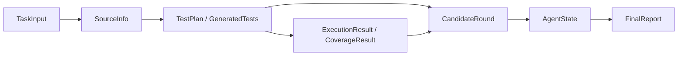

# 测试生成 Agent 技术设计

> 当前进度：A1、A2、A3、B1、B2 已完成，B3 的生成/反馈 Prompt 与离线验证已完成。当前提供配置检查 CLI、DeepSeek 结构化生成适配层、正式 Prompt 构建入口、环境验证入口及模块间的数据契约；B3 真实请求尚待明确授权将公开样例源码和说明发送给 DeepSeek。通用源码分析、执行工具和 Agent 反馈循环尚未实现；本文其余任务接口、状态和输出目录仍是后续实现约定。A3 的手写测试不是模型生成结果。

## 1. 范围与验收（A1）

### 1.1 产品目标与边界

输入一个小型 Python 源码文件及可选行为说明，Agent 生成 pytest 测试，实际执行测试，读取失败和覆盖率反馈，在有限轮次内修复生成错误或补充场景，最后保存测试、报告和运行轨迹。

- 初版处理单个 `.py` 文件中的 1–5 个顶层同步纯函数，覆盖数字计算、字符串、列表和输入校验。
- 被测文件允许使用标准库；生成测试允许使用标准库和 pytest。暂不支持外部依赖、相对导入、依赖原文件位置的资源读取、异步函数或复杂类结构。
- 只执行本地可信课程样例；临时工作目录和执行超时不构成完整安全沙箱。
- 不自动安装依赖，不修改原始源码，不处理大型仓库、多语言、服务或数据库测试，也不引入长期记忆或多 Agent 协作。
- 保留一次任务内的源码、行为依据、计划、候选和工具反馈；后续请求需要使用这些反馈。
- 最多执行 3 轮候选：首轮生成，加最多 2 轮反馈迭代。模型调用重试不能增加候选执行轮数。

本项目对应课程的测试生成方向：真实 LLM 生成、pytest 工具调用、反馈驱动的 Agent 循环和 CLI 属于核心验收；覆盖率、报告和缺陷检出提供验证证据。A1 只固定这些约定，不代表端到端功能已验收。

### 1.2 输入约定

相对路径以启动命令时的当前工作目录解析，宿主程序保存解析后的绝对路径。输入文件不被覆盖；输出目录不能覆盖源文件或说明文件。

| 输入字段 | 必填 / 默认 | 约束及含义 |
|---|---|---|
| `source_path` | 必填 | 已存在、可读的单个 `.py` 文件；按 Python 源码编码声明读取，必须通过语法检查并包含支持的目标函数。初版大小上限 64 KiB，超限报输入错误。 |
| `spec_path` | 可选，默认无 | 已存在、可读的 UTF-8 文本或 Markdown 文件，初版大小上限 64 KiB；说明输入域、返回值、边界及异常。显式提供但不存在或不可读时应报错，不能静默忽略。 |
| `output_dir` | 可选，默认 `outputs/` | 宿主程序在目录下创建唯一 `run_id` 子目录；不存在则创建，已有运行不覆盖。无法创建时报告输出错误。 |
| `model_config` | 必填，由配置层读取 | 包含服务商 `provider`、实际可用的模型标识 `model`、服务地址 `base_url`、API Key 的环境变量名 `api_key_env`、请求超时 `request_timeout_seconds`（默认 60 秒）。A2 按用户选择固定当前支持服务商为 DeepSeek，服务地址默认 `https://api.deepseek.com`；模型无默认值，须在 A3 验证实际权限。密钥不写入源码、报告或轨迹。配置来源见第 2 节。 |
| `max_rounds` | 可选，默认 `3` | 整数，范围 `1..3`，含首轮；`1` 表示一次性生成并执行。0、负数或超过 3 都报输入错误，不静默修正。 |
| `execution_timeout_seconds` | 可选，默认 `30` | 整数，范围 `1..300` 秒；限制单轮测试子进程运行时间，区别于模型请求超时。到期终止该次执行并记录超时。 |

配置不全、路径无效、语法错误、无目标函数或超出支持范围时，应在生成前给出原因。API 权限及模型可用性由真实请求验证，不能仅因字段非空而宣称通过。

预期行为依据的使用规则：

1. 提供说明文件时，结合说明与源码 docstring 建立测试依据；两者矛盾时记录具体冲突，进入 `needs_review`，不能擅自选择其中之一。
2. 没有说明文件但 docstring 足够明确时，以 docstring 为依据。
3. 二者都缺少明确约定时，可生成基于当前实现的特征测试，标记 `oracle_mode = characterization`；它们只描述现有行为，不能证明符合需求。
4. 有明确行为约定时标记 `oracle_mode = specification`。每个场景记录预期来源；说明未定义的输入不擅自补充异常类型或返回值。

### 1.3 输出约定

宿主程序决定文件名及路径，LLM 只返回测试内容和分析数据。每次运行采用下列布局（设计示例，尚未实现）：

```text
<output_dir>/<run_id>/
├── subject.py                  # 原始源码副本，固定导入名 subject
├── test_subject.py             # 最终选定候选，不是各轮代码的随意合并
├── report.md                   # 面向使用者的报告
├── report.json                 # 同一份报告数据的结构化输出
├── trace.jsonl                 # 状态、工具反馈、动作及简短选择理由
└── rounds/
    ├── 01/
    │   ├── test_subject.py      # 本轮候选；收到内容后即保留
    │   ├── test_plan.json       # 场景、测试函数及预期依据
    │   ├── execution.json      # 真实执行结果或未执行原因
    │   ├── stdout.txt
    │   ├── stderr.txt
    │   └── coverage.json       # 实际采集成功时才存在
    └── ...                     # 最多 03
```

- `test_subject.py` 使用 `from subject import <函数名>` 导入。配合相邻的 `subject.py`，从运行目录执行 `python -m pytest test_subject.py`；单独复制测试文件并不能保证导入成功。
- 若没有可用候选，顶层 `test_subject.py` 不生成，报告中的最终测试路径为 `null`；错误候选仍留在轮次快照中。不能用空文件代替成功结果。
- `report.md` 和 `report.json` 至少包含：输入及行为依据模式、模型标识与非敏感配置、最终状态、停止原因、实际轮数与调用次数、场景及依据、首轮和最终候选结果、最终文件与快照位置、未解决问题。
- 执行结果至少展示退出码、收集数、实际执行数、通过/失败/错误/跳过数和超时标记；模型不能填写这些实际测量值。
- 覆盖率至少展示目标文件、已覆盖/总语句、已覆盖/总分支、百分比、缺失行和分支。范围仅限 `subject.py`，不包含测试或 Agent 代码，不叠加不同轮的数据。
- 覆盖采集失败时标记为不可用并说明原因；分母为 0 时标记为不适用，不能填 100%。失败候选的覆盖率可展示，但需要同时标明该候选失败。
- `trace.jsonl` 记录时间、轮次、状态、动作、工具名称、输入/返回摘要和选择理由，不包含密钥或模型内部思维过程。
- 在输出目录可写时，即使任务失败也保存报告及已有证据；若目录本身不可写，至少向终端输出具体原因，不能承诺文件已保存。

### 1.4 独立结果维度

下列指标分别记录，不能互相替代：

| 维度 | 判定条件 | 不足以说明什么 |
|---|---|---|
| 生成文件 | 已写出候选测试内容；另记录是否通过语法校验 | 不代表 pytest 能导入、收集或执行。 |
| 候选可运行 | 语法/导入/收集成功，至少实际执行 1 条测试，执行正常结束，无超时、收集/fixture/框架错误；断言失败允许存在 | 不代表断言通过或源码正确。 |
| 测试全部通过 | 可运行，实际执行非空，失败及错误数均为 0；完成验收还要求无 skip/xfail 等绕过 | 不代表覆盖充分，特征测试也不证明规格正确。 |
| 覆盖达到目标 | 工具实测行覆盖率 ≥ 90%、分支覆盖率 ≥ 80%；无分支时分支目标不适用，行语句分母为 0 时不能验收为充分 | 不代表断言有效或没有 Bug；这些阈值是本项目停止策略，不是课程硬性要求。 |

仅跳过、仅 xfail、无测试收集的候选不能成为可用结果。混合执行中存在 skip/xfail/xpass 时不能进入 `completed`。后续执行结果结构需要单独记录这些绕过情况。

### 1.5 最终状态与判定顺序

状态描述本次任务的交付程度，不是对被测源码质量的认证。按以下顺序判断，保证结果互斥：

| 顺序 / 状态 | 判定条件 | 典型例子与必须保留的内容 |
|---|---|---|
| 1. `needs_review` | 存在明确规格支持的失败断言、规格/docstring 冲突，或影响结论的预期/失败归因无法确定 | 测试能运行，但“满 100 打九折”失败。保留输入、预期、实际、依据和失败候选；标记疑似源码缺陷，不能改断言迎合实现。冲突也可在执行前触发此状态。 |
| 2. `failed` | 不满足人工复核条件，且没有任何可用候选或输入无法进入流程 | 无效输入、模型请求失败且无历史候选、所有候选语法/导入错误、无测试、仅跳过或全部执行超时。列出错误和已完成步骤。 |
| 3. `completed` | 有可用最终候选，全部通过且无绕过，目标范围覆盖达到上述阈值，无未解决错误或疑问，必要报告与轨迹成功保存 | 生成、执行、覆盖和交付均完成；特征测试模式仍必须明确标记其结论范围。 |
| 4. `partial` | 有可用候选、没有待人工复核的行为问题，但未满足 `completed` 的某项要求 | 全通过但覆盖不足/不可用，达到轮次上限、无进展，或后续 API/执行/报告错误导致未完成。保留上一轮可用候选并说明限制。 |

人工复核证据不会因后续 API 或覆盖率错误被降格成普通执行错误；报告同时列出这些错误。否则，不可恢复错误发生后是否存在历史可用候选，决定 `partial` 或 `failed`。

最终候选必须来自某个保存的轮次，并记录轮次号。对 `needs_review` 保留与复核问题相关的候选和证据；不能只展示此前通过的版本来掩盖有效失败。追加候选无效时可退回历史可用候选，但当前失败快照和未解决问题仍须出现在报告中。候选排序的具体实现留到 E 阶段。

停止原因另行记录，不与最终状态混用，例如 `coverage_target_met`、`round_limit_reached`、`no_progress`、`suspected_source_defect`、`ambiguous_specification`、`execution_timeout`、`unrecoverable_error`。达到预算上限不会自动变成 `completed`。

### 1.6 三个最小样例

样例源码和行为说明一一对应，docstring 与说明保持一致。均只使用标准 Python、无外部依赖、无文件或网络副作用。

| 类型 | 源码 / 说明 | 人工核验的关键预期 | 后续 Agent 验收目标 |
|---|---|---|---|
| 正常计算 | `examples/calculation.py` / `examples/calculation.md` | `calculate_total(12, 3) == 36`；`(0, 5)`、`(12, 0)` 都为 0 | 非空有效测试可运行，正常与零值边界通过；目标行覆盖达标，分支不适用。 |
| 多分支校验 | `examples/validation.py` / `examples/validation.md` | 0/59 为 `fail`，60/89 为 `pass`，90/100 为 `excellent`；-1/101 抛 `ValueError`，浮点/字符串/布尔值抛 `TypeError` | 覆盖类别边界和类型/范围错误。若首轮遗漏分支，反馈应引导追加；不能保证模型首轮一定遗漏。 |
| 明确规格下的缺陷 | `examples/discount.py` / `examples/discount.md` | 99 → 99，100 → **90**，101 → 90；源码在 100 时实际返回 **100** | 生成规格支持的断言，实际执行发现阈值错误，进入 `needs_review`，保留断言和疑似缺陷证据。 |

计算样例的非负整数输入域是前置条件，域外行为未定义；不要求自动生成不存在的输入校验。校验样例明确排除 `bool`。折扣样例约定向下取整，避免浮点或金额舍入歧义。

说明文件中公开的输入输出是任务规格及人工核验锚点；后续评测的隐藏参考测试和错误变体答案不能混入模型输入。缺陷样例只展示一次确定的边界错误，不代表 Agent 已具备自动缺陷检出能力。

### 1.7 A1 验收记录

- 已固定六类输入、默认值和非法输入处理。
- 已固定最终测试、双格式报告、轨迹及每轮快照的输出约定。
- 已分开生成、可运行、全部通过与覆盖充分四个维度，并定义四个最终状态及判定优先级。
- 已准备三个源码文件和三个 UTF-8 行为说明，覆盖正常计算、多分支校验和明确规格缺陷。
- 2026-09-26 使用本地 Python 3.13.9 做三个源码文件的语法/导入检查及 32 项行为核验（含整数子类、异常类型和已知缺陷确认）：正常计算与校验符合规格；折扣的 100 边界确实得到 100，违反预期 90。该偏差为有意保留的课程样例。核验前后源码 SHA-256 一致，未产生缓存或修改源码。

本记录不替代 A3 的真实 API、样例 pytest 和 coverage 验收；A2 的工程环境和依赖验收见第 2 节。

## 2. 工程骨架与 DeepSeek 配置（A2）

### 2.1 环境及依赖

2026-09-26 在 Windows x64 上创建独立 `.venv`，使用 CPython **3.13.9**（虚拟环境内 pip 25.2）。项目元数据限定 `>=3.13,<3.14`，当前未宣称其他 Python 版本或平台已验证。

| 依赖 | 已安装并验证的版本 | 职责 |
|---|---|---|
| httpx | 0.28.1 | DeepSeek API 的同步 HTTP 请求；离线测试使用 MockTransport |
| pydantic | 2.13.5 | 配置类型、范围和必填项校验；后续用于模型响应结构校验 |
| python-dotenv | 1.2.3 | 读取指定 UTF-8 `.env` 文件 |
| pytest | 9.1.1 | Agent 自身测试及后续生成测试的执行框架 |
| coverage | 7.16.1 | 后续目标文件行/分支覆盖率采集 |
| setuptools / wheel | 84.0.0 / 0.48.0 | 构建及 editable 安装 |

`pyproject.toml` 固定直接与构建依赖，`requirements.lock` 固定本次安装的 **21 个直接、传递和构建依赖**；不包含本地项目或 pip。安装顺序为先安装锁文件，再以 `--no-index --no-build-isolation --no-deps -e .` 安装本地工程，防止构建阶段另行解析依赖。锁文件是已验证环境的版本快照，未做跨平台或包哈希锁定；具体复现命令见 README。

pytest 默认只收集 `tests/`，防止把被测样例或未来生成测试混入 Agent 自身验证。`pyproject.toml` 中的 coverage 设置针对 Agent 自身；D 阶段的执行工具必须另行限定本次 `subject.py`，不能沿用 Agent 的统计范围。

### 2.2 已建立模块与入口

```text
AgentDev/
├── pyproject.toml / requirements.lock
├── .gitignore / .env.example
├── README.md / Design.md / TASK_CHECKLIST.md
├── src/testgen_agent/
│   ├── __init__.py / __main__.py
│   ├── cli.py / config.py / llm_client.py
│   ├── models.py / prompts.py / agent.py / reporting.py
│   └── tools/
│       ├── __init__.py
│       ├── source_reader.py / code_analyzer.py / test_runner.py
├── tests/test_config.py
├── examples/                  # A1 的三个样例及说明
└── evaluation/                # 后续评测目录
```

- `python -m testgen_agent` 和安装后的 `testgen-agent` 使用同一个 CLI 入口；当前实现 `--help`、`--version`、`--check-config` 及配置覆盖参数。
- `config.py` 完成配置读取、校验与脱敏摘要，`llm_client.py` 提供配置驱动的 HTTP 客户端工厂；客户端创建不会发送请求。
- A2 阶段创建了 `models`、`prompts`、`agent`、`reporting` 及源码/执行工具骨架；此后 `models`、`prompts` 已分别在 B1、B3 实现，`agent`、`reporting` 及源码/执行工具仍保留为后续阶段骨架。各模块均不包含模拟成功的业务结果。
- `outputs/` 和临时工作目录由后续实际运行时创建，并由 `.gitignore` 排除；设计内容统一写入本文件，没有创建 `docs/scope.md`。

### 2.3 配置来源与约束

优先级：**命令行覆盖 > 进程环境变量 > 选定 `.env` 文件 > 默认值**。不搜索父目录，不通过 dotenv 修改 `os.environ`，不展开 `${...}`。支持 UTF-8 及 UTF-8 BOM；显式指定不存在的文件时报配置错误，默认 `.env` 不存在时仍可使用环境变量。

| 配置项 | 环境变量 | 默认值 / 校验 |
|---|---|---|
| provider | `LLM_PROVIDER` | `deepseek`；当前拒绝其他服务商 |
| model | `LLM_MODEL` | 无默认值；必须填写非占位符模型标识 |
| base_url | `LLM_BASE_URL` | `https://api.deepseek.com`；有效 HTTP(S) 地址，不含用户名、密码、查询或片段 |
| api_key_env | `LLM_API_KEY_ENV` | `DEEPSEEK_API_KEY`；必须为合法环境变量名 |
| api_key | 上一行指定的变量 | 无默认值；缺失、空值、占位符或含空白的 Key 均拒绝 |
| request_timeout_seconds | `LLM_REQUEST_TIMEOUT_SECONDS` | 60；1..600 的整数 |
| max_rounds | `AGENT_MAX_ROUNDS` | 3；1..3 的整数 |
| execution_timeout_seconds | `TEST_EXECUTION_TIMEOUT_SECONDS` | 30；1..300 的整数 |

命令行可覆盖除 Key 明文外的上述设置；Key 只能来自文件或环境变量。Key 使用 `SecretStr`，从对象 repr 和序列化输出排除；公开摘要仅额外返回 `api_key_configured` 标志。配置错误按字段给提示，不输出原始被拒绝值。

配置检查返回 0 表示本地校验通过；参数或配置错误返回 2。此状态只反映配置，不等同于 A1 的任务 `completed`。缺少运行模式时 CLI 提示使用 `--check-config` 或 `--help`；当前不提供源码输入或生成运行命令。Windows 非终端输出统一采用 UTF-8，以便重定向后正确读取中文。

### 2.4 DeepSeek 接入约定

按用户选择使用 DeepSeek 原生 HTTP 调用，不引入 Agent 框架。官方接口为 Bearer 认证的 `POST /chat/completions`，请求体包含模型及消息；本地客户端使用 httpx，后续由独立适配层组织请求及解析响应。[DeepSeek 首次调用说明](https://api-docs.deepseek.com/zh-cn/)、[Chat Completions 接口](https://api-docs.deepseek.com/api/create-chat-completion/)

客户端从配置读取地址、密钥和超时，以相对路径 `chat/completions` 发起调用，保留可配置的 `/v1` 前缀，不跟随重定向；HTTPX 默认不自动重试。A2 不实现真实生成方法、退避策略或响应修复，这些预算和错误处理在 B2 中实现。

`request_timeout_seconds` 当前设置 HTTPX 的连接、读、写及连接池等待超时，不表示整个响应的总墙钟时限；`execution_timeout_seconds` 将在 D 阶段用于测试子进程的总执行时限，两者不混用。

模型名没有默认值，`.env.example` 中仅提供模型和密钥占位符，使用者必须替换。官方文档列出的模型只是选择参考，不能替代账号真实权限验证；最终模型标识、测试日期、延迟和用量在 A3 记录。A2 不保存真实 Key，不发送付费 API 请求。

### 2.5 A2 验收记录

- `.venv` 已创建；项目 editable 安装成功，两个入口的帮助/版本可用。
- 直接及传递依赖已安装，21 项版本锁文件在当前环境解析通过，`pip check` 返回 `No broken requirements found`。
- 24 项自身测试通过，覆盖文件/环境/命令行优先级、占位符与必填项、轮次/超时边界、敏感信息隐藏、UTF-8 重定向输出，以及离线 HTTP 客户端的路径、认证和超时设置。
- `.gitignore` 排除 `.env`、虚拟环境、缓存、打包目录、运行目录及覆盖率中间文件；`.env.example` 保留为可分发配置示例。
- 真正的模型访问、手写样例 pytest 和 coverage JSON 验证仍属于 A3，没有提前勾选。

## 3. 真实 LLM 与测试环境验证（A3）

### 3.1 验证方式与可复现入口

新增 `python -m testgen_agent.smoke` 作为阶段 A3 的环境验证入口，与未来的测试生成 Agent 分开。其源码位于 `src/testgen_agent/smoke.py`；手写测试位于 `validation/handwritten/test_calculation.py`，不参与 `tests/` 的 Agent 自身测试收集。

完整验证从当前 `.env` / 环境变量读取配置，也可通过 `--model` 覆盖模型；仅本地验证时使用 `--skip-llm`，不需要密钥。每次运行创建唯一 `outputs/a3/<run_id>/`，保存源码副本、手写测试副本、pytest JUnit XML、coverage JSON、工具输出和 `validation.json`。

```powershell
.\.venv\Scripts\python.exe -m testgen_agent.smoke
# 仅验证本地工具，不发送 API 请求
.\.venv\Scripts\python.exe -m testgen_agent.smoke --skip-llm
```

完整模式只发送 **1 次**非流式 Chat Completions 请求，不自动重试；提示为 `Reply with exactly OK and nothing else.`，关闭 thinking，`max_tokens=16`。本次验收条件为 HTTP 200、内容为 `OK`、结束原因 `stop`，且响应耗时不超过 30 秒。这是一条最小连通性请求，不上传项目源码，也不验证模型生成测试的质量。

本地工具验证将 `examples/calculation.py` 复制为 `subject.py`，将手写测试复制为 `test_subject.py`。使用当前虚拟环境解释器运行 `coverage run --branch -m pytest` 并导出 JSON；显式传入独立的 pytest/coverage 配置和目标文件过滤，防止继承工程的 Agent 覆盖范围。测试子进程只接收必要 OS 环境变量，不接收 LLM Key，且限制测试执行及覆盖导出单次超时（默认 30 秒）。

`--skip-llm` 成功时退出码为 0，但结果中 `llm.status = skipped`、`a3_passed = false`，不能据此宣称 A3 全部完成。完整模式必须两项验证均通过才返回 0；任一失败返回 1。输入参数无效返回 2。配置/API 错误不记录认证头、密钥、任意响应正文或异常原文。

### 3.2 DeepSeek 实测记录

测试日期：**2026-09-26 19:39（Asia/Shanghai）**，对应 UTC `2026-09-26T11:39:08.944869+00:00` 的运行开始时间。此前以本地 Key 查询 `GET /models`，HTTP 200，实际返回 `deepseek-flash` 和 `deepseek-v4-pro`；选用前者进行真实请求，成功后将本地忽略文件 `.env` 的模型占位符替换为 `deepseek-flash`，原 Key 未改动。

| 项目 | 实测结果 |
|---|---|
| 服务商 / 地址 | DeepSeek / `https://api.deepseek.com` |
| 请求模型 / 响应模型 | `deepseek-flash` / `deepseek-flash` |
| 请求方式 | `POST /chat/completions`，非流式，关闭 thinking |
| 请求次数 | Chat 请求 1 次；另有一次成功的模型列表查询 |
| HTTP 状态 / 输出 | 200 / `OK` |
| 结束原因 | `stop` |
| 响应耗时 | 1.267 秒（含连接和响应读取） |
| 实际用量 | prompt 12、completion 1、total 13 tokens |
| 缓存用量 | hit 0、miss 12 tokens |

用量直接取自服务返回值，未估算费用。本次耗时低于 30 秒的验证阈值，只代表这一次最小请求，不能证明较长测试生成请求也有相同延迟。Key、认证请求头和完整请求/响应未保存到可提交证据中。

### 3.3 手写 pytest 与 coverage 实测记录

手写三条测试：普通购买 `12 * 3 == 36`；零价格/零数量（含二者都为零）；大整数 `1000000 * 1000000 == 1000000000000`。均以 A1 的行为说明为依据，未使用 LLM 返回固定测试伪装成生成结果。

| 项目 | 实测结果 |
|---|---|
| Python / pytest / coverage | 3.13.9 / 9.1.1 / 7.16.1 |
| pytest / coverage JSON 导出退出码 | 0 / 0 |
| 测试数 / 通过数 | 3 / 3 |
| 失败 / 错误 / 跳过 | 0 / 0 / 0 |
| 覆盖范围 | 仅 `subject.py`；不包含测试或 Agent |
| 行覆盖 | 2 / 2，100%；执行行 4 和 9，缺失行为空 |
| 分支覆盖 | 总分支 0，不适用；规范化结果使用 `null`，不写为 100% |
| 原始源码 | 核验前后 SHA-256 一致，未修改 |

原始 coverage JSON 对无分支情形可能给出百分比 100；验收摘要依据分母为 0 显示不适用。该样例只确认导入、执行及目标文件统计可用，不替代 D 阶段的失败、超时和多分支统计验证。

### 3.4 保存的验收证据与进度

- [evaluation/a3_validation.json](evaluation/a3_validation.json)：两项真实验证的结构化结果，含日期、模型、耗时、用量、版本及源码摘要；`a3_passed = true`。
- [evaluation/a3_coverage.json](evaluation/a3_coverage.json)：该次工具导出的原始目标覆盖 JSON。
- [evaluation/a3_pytest.xml](evaluation/a3_pytest.xml)：该次 pytest 的 JUnit XML。
- 本地完整产物目录：`outputs/a3/20260926T113908Z-0315ebb0/`，由 Git 忽略；上述精选证据保留在可提交目录。

Agent 自身测试扩充至 **33 项并全部通过**，新检查覆盖最小请求、实际用量读取、认证/余额/限流失败、空/截断/错误响应和子进程环境隔离；这些自动测试使用 MockTransport，不发送 API 请求。真实 API 验收来自本节单独记录的服务响应。

阶段 A 的范围、环境和真实 API/工具验证已完成。B1、B2、B3 的后续记录分别见第 4、5、6 节；后续 Agent 流程仍未实现。

## 4. 模块间数据结构（B1）

### 4.1 核心数据契约

实现位置：`src/testgen_agent/models.py`，沿用已验证的 pydantic 2.13.5，不增加依赖。下表中的生产/消费关系是后续模块必须遵守的接口，当前完成的是类型、结构校验和序列化。

| 核心结构 | 主要字段 | 生产方 → 消费方 |
|---|---|---|
| `SourceInfo` | `source_path`、`source_code`、`encoding`、`functions`、`imports`、`branches`；函数信息含名称、签名、docstring 和起止行 | C1 源码工具 → Prompt / 控制器 |
| `TestPlan` | `target_functions`、`oracle_mode`、`scenarios`；场景含 ID、目标函数、类别、参数、预期行为及依据 | B2/B3 模型输出 → 生成校验 / 反馈上下文 |
| `GeneratedTests` | `plan`、`code`、`mappings`、`assumptions`、`questions` | B2 适配层校验后的模型内容 → C2 候选写入 / 控制器 |
| `ExecutionResult` | `kind`、`exit_code`、收集/执行/各结局计数、stdout/stderr、超时、日志截断及耗时 | D1 执行工具 → 控制器 / 报告 |
| `CoverageResult` | `target_file`、可用状态、覆盖/总语句及分支、缺失行/弧、采集错误；百分比由计数计算 | D2 覆盖工具 → 控制器 / 报告 |
| `AgentState` | 原始 `request`、源码和行为说明、依据模式、当前轮次、历史候选、最佳可用轮次、下一步动作、停止原因、问题、调用数和用量 | 宿主控制器维护 → 下一轮上下文 / 报告 |
| `FinalReport` | `schema_version`、任务状态、停止原因、输入、所有轮次、选定轮次、最终测试/轨迹路径、未解决问题、调用数及用量；`metrics` 从选定轮次读取 | 宿主控制器 → G2 Markdown/JSON 报告 |

契约的数据流如下；实际生成、执行和决策流程仍由后续阶段实现：



辅助类型将含义明确的记录独立建模：`FunctionInfo`、`ImportInfo`、`SourceBranch`、`ScenarioInput`、`ExpectedBasis`、`TestScenario`、`TestCaseMapping`、`BranchArc`、`CandidateRound`、`Issue`、`TokenUsage`、`ReportMetrics`。`TaskInput` 保留输入和运行预算，`ModelInfo.from_config()` 只提取服务商、模型、地址及请求超时，不包含 Key。

### 4.2 模型内容与工具实测结果分离

模型生成内容统一按 `GeneratedTests` 校验。它的根字段只有计划、代码、对应关系、假设和疑问；不接受执行结果、覆盖率、实际通过数、最终状态、调用次数或输出路径。嵌套对象也禁止额外字段，不能通过场景参数对象夹带指标字段。

场景参数以 JSON 可表达的值记录：`args` 为位置参数序列，`kwargs` 为参数名到值的映射。正常、边界、异常、分支场景使用固定类别；预期依据必须标记为说明规格、docstring 或当前实现假设，并给出具体说明。特征测试模式的场景只能标记当前实现假设。

计划目标、场景 ID 和测试函数对应关系需要一致：目标和场景 ID 唯一，场景函数属于计划目标，映射中的 ID 恰好覆盖计划场景，一个测试函数可以通过参数化对应多个场景。映射名须为 `test_` 开头的 Python 标识符。源码元数据的目标函数限定 1–5 个，名称不重复，行号在源码范围内。

全部预期无法确定时，允许返回 `code = null`、空映射和非空 `questions`，保留疑问而不编造测试。返回代码时必须有非空计划及完整映射。测试代码的 AST、导入、有效断言及映射函数是否真实存在仍在 C2 校验。

字段分离不能证明数据实际来自一次工具调用。B2 只解析模型的 `GeneratedTests`；D 阶段必须从真实工具返回值构造 `ExecutionResult` / `CoverageResult`，宿主负责其来源与对应轮次。

### 4.3 执行结果的口径和约束

计数使用非负严格整数，不将字符串、布尔值或小数转换成计数。未观测到的计数为 `null`，超时或进程未启动时不能默认填写“通过 0 条”来假装已取得统计。

`kind` 分别表示 `passed`、`assertion_failed`、`execution_error`、`collection_error`、`internal_error`、`usage_error`、`interrupted`、`no_tests`、`timeout`、`launch_error`。普通 pytest 结果与对应退出码保持一致；超时类型和 `timed_out` 标志必须相符，进程未启动时退出码为 `null`，且不允许报告非零测试项计数。

- `collected`：收集到的不同测试项数，参数化实例分别计数。
- `executed`：实际进入 call 阶段的不同测试项数，由工具独立观测；setup 失败和纯跳过不计入，call 阶段发生的 xfail 可计入。
- `passed`、`failed`、`errors`、`skipped`、`xfailed`、`xpassed`：结束运行时的互斥最终结局。setup/teardown 错误优先记为 errors，其他诊断保留在日志；不能将一个测试的 call 通过与 teardown 错误重复计为两个结局。
- 对 `passed` / `assertion_failed` / `execution_error` 的完整执行，所有计数必须已知，结局合计等于收集数。收集错误等非完整执行允许计数未知；其 errors 可表示收集错误，不套用测试项合计约束。

`runnable` 和 `all_passed` 是只读派生字段。可运行要求无超时/框架错误、确实执行非空普通测试；断言失败仍可运行。仅 skip/xfail/xpass 的候选不能成为可用结果；混合跳过、xfail 或 xpass 的候选不能达到全部通过验收。全通过还要求非空测试、所有收集项实际通过、无失败/错误/绕过。

### 4.4 覆盖率与未知指标

`CoverageResult.status = available` 时，语句和分支计数必须已知，已覆盖数量不能超过总数量，缺失位置不得重复，缺失数量须与总数减覆盖数一致。缺失行号是源码位置，不能错误地以“语句数”为行号上限。`BranchArc` 使用有符号行号，保留工具可能给出的负数退出弧，拒绝 0 行号。

采集不可用时使用 `status = unavailable` 和错误原因，计数均为 `null`，不填猜测值或伪造缺失位置。行/分支百分比是只读计算字段；分母为 0 时返回 `null`。`meets_target` 按 A1 的 90% 行、80% 分支策略计算；无分支时不应用分支阈值，行分母为 0 时不能达到目标。

覆盖数据可属于断言失败的候选，因此单独记录在同一轮快照中；报告同时保留执行失败信息。实际目标文件过滤、新数据隔离及采集错误处理由 D2 完成。

### 4.5 历史快照与状态引用

`AgentState.history` 是 `CandidateRound` 的有序元组，轮次从 1 连续编号，长度不超过输入预算；`current_round` 与历史长度一致，初始状态为 0。可以先保存待处理的轮次快照，再以经校验的新快照补入生成、执行和覆盖结果。尚未执行时使用 `execution = null`，未采集时使用 `coverage = null`。

执行结果必须关联已生成、未被候选校验判定无效的代码；覆盖记录需要同轮执行记录。生成计划的函数须来自已分析源码，依据模式不得改变原始任务模式。最佳可用轮次必须引用真实历史中的可运行候选，不自动选择或重新排序候选。

`Issue` 保存问题类别、摘要、证据及可选的轮次/场景引用；提供引用时检查其存在性。后续候选无效时，历史保留其校验错误，可以继续指向上一轮可用候选；规格失败的执行和疑似缺陷证据也保留在快照中。停止原因已设置时，下一步动作只能为 `finish` 或 `request_review`。

模型禁止直接属性赋值，历史及结构化列表使用元组；`updated(**changes)` 会重新校验修改后的完整对象。JSON 参数内部的 dict/list 仍可变，后续 E 阶段归档应保存独立快照，不能依赖浅层冻结实现深层不可变。不要以绕过校验的 `model_construct()` 或 `model_copy(update=...)` 更新任务状态。

### 4.6 最终报告与序列化

`FinalReport` 使用版本标识 `1.0`，要求选定轮次和最终文件路径同时存在或同时为空。选定轮次必须可用；报告的指标从该轮执行/覆盖记录读取，调用次数来自宿主，Token 用量未知时使用 `null`，已知组件合计须一致。

状态自洽校验包括：

- `completed`：选定候选全部通过、覆盖达到目标、提供轨迹路径、没有未解决问题/疑问，停止原因为覆盖目标达成。
- `partial`：存在可用最终候选，且没有需要人工复核的行为问题；可保留失败的后续候选及运行限制。
- `needs_review`：保留疑似源码缺陷/规格歧义问题，或选定候选的未解决疑问；在规格冲突导致尚未执行时，也可以没有最终候选。
- `failed`：没有历史可用候选，也没有需要优先人工复核的证据；最终测试路径为空。

这些校验保证字段和值的关系一致。实际失败归因、状态选择、候选排序和停止决策仍由 E 阶段控制器执行；文件是否真实落盘由工具和报告模块验证，数据模型本身不读写输出文件。

所有核心结构支持 JSON Schema：`model_json_schema(mode="validation")` 用于输入校验，`mode="serialization"` 描述含只读派生指标的输出。模型生成边界使用 `GeneratedTests` 的输入 Schema。

```python
# 从模型响应解析生成内容（实际 API 适配在 B2 实现）
generated = GeneratedTests.model_validate_json(response_text)
# 保存可重新校验的原始字段快照，不重复存储派生指标
snapshot = state.canonical_json()
restored = AgentState.model_validate_json(snapshot)
# 输出报告时包含从同一份结果计算的只读 metrics / 百分比
report_data = report.model_dump(mode="json")
```

`canonical_json()` 采用 `round_trip=True` 排除派生字段，路径转换为字符串、元组转换为 JSON 数组并保留中文；恢复时重新执行结构校验。普通报告输出包含派生字段，这些字段不作为输入接收，避免写入与计数不一致的百分比。实现遵循 [Pydantic 序列化](https://docs.pydantic.dev/latest/concepts/serialization/) 和 [模型校验](https://docs.pydantic.dev/latest/concepts/validators/) 接口，已针对本地锁定版本验证。

### 4.7 B1 验收记录

2026-09-26 完成七个核心模型、辅助记录、动作/停止原因/状态枚举及公共模型配置快照。新增 **60 项数据契约测试**，加上原有 33 项，总计 **93 项全部通过**；以 `-W error` 执行，无警告，`pip check` 通过。

验收覆盖：七类 JSON Schema 和原始字段序列化往返、中文保留、非法/额外字段、生成结果与工具指标隔离、场景映射、严格计数、执行失败及绕过、零分母与覆盖不可用、历史预算和引用、退回旧候选、规格失败需复核、最终状态及指标一致性。测试中的任务和缺陷证据均为合成数据，不宣称已执行 Agent 端到端任务。

另外将已有 A3 的真实 JUnit XML、覆盖率 JSON 和服务用量读入对应数据模型，核对三条测试通过、2/2 行覆盖、无分支和 13 tokens；新契约与已保存工具证据一致，验证未发送 API 请求。A3 原始产物及本地 `.env` 未修改。

B1 仅固定并验证模块间的数据结构；B2、B3 的实现与验收记录见第 5、6 节，C/D/E 和正式报告输出仍按任务清单继续实施。

## 5. DeepSeek LLM 适配层（B2）

### 5.1 统一接口与职责边界

实现位置为 `src/testgen_agent/llm_client.py`。业务入口是 `DeepSeekClient.generate_tests(context)`；也提供同名模块函数，便于不复用客户端对象的调用方使用。输入 `GenerationContext` 只包含 `system_instruction` 与 `user_prompt`，输出 `LLMGenerationResult` 包含经本地校验的 `GeneratedTests`、请求/响应模型、尝试次数、格式修复次数、总耗时、每次成功响应记录和累计 token 用量。

B2 不决定完整测试策略。B3/E 负责生成或反馈 Prompt 的实际内容，适配层负责：

- 从 `AppConfig` 读取服务地址、模型、Key 和请求超时；创建不含 SDK 自动重试的 HTTPX 客户端。
- 自动在 system 消息后附加 `GeneratedTests.model_json_schema(mode="validation")`，并明确要求只输出一个 JSON 对象。
- 通过 DeepSeek `POST /chat/completions` 非流式请求，关闭 thinking，启用 `response_format = {"type": "json_object"}`。
- 从响应取得内容、模型、ID、结束原因和实际用量；使用 `GeneratedTests.model_validate_json()` 做本地结构及跨字段校验。
- 只返回校验通过的生成内容；不在适配层写测试文件、执行 pytest 或构造工具实测值。

默认 `max_tokens=4096`，构造时允许 `1..32768`。DeepSeek 官方 JSON Output 要求 Prompt 同时明确要求 JSON，本实现同时使用 `response_format` 和 Schema 指令；接口定义及结束原因参见 [Chat Completions 官方文档](https://api-docs.deepseek.com/api/create-chat-completion/)。

### 5.2 超时、重试和修复预算

HTTPX 客户端的 connect/read/write/pool 超时统一取 `LLM_REQUEST_TIMEOUT_SECONDS`，不启用传输层自动重试。业务层默认预算如下：

| 预算 | 默认值 | 规则 |
|---|---:|---|
| 瞬时故障重试 | 2 次 | 只处理网络/超时、HTTP 408/409/429 和 5xx |
| 格式修复 | 1 次 | 只处理 HTTP 200 且有内容、但未通过 `GeneratedTests` 校验的输出 |
| HTTP 总尝试 | 最多 4 次 | `1 + 2 + 1`；瞬时重试和格式修复共享此硬上限 |
| 退避 | 0.25、0.5 秒起，最多 2 秒 | 指数退避；有效 `Retry-After` 优先，但同样截断到 2 秒 |

格式修复把此前输出作为 assistant 数据（最多 20,000 字符），追加一条只要求修正完整 JSON 的 user 消息，Schema 仍由原 system 消息提供。第二次仍不合法时返回 `invalid_generated_output`，不继续循环。若前序请求已经消耗总预算，修复或瞬时重试随即停止。

HTTP 400、401、402、403、404 分别归类为无效请求、认证、余额、权限和不存在错误，立即结束；429 和短暂网络/服务错误在预算内重试。HTTP 200 但外层响应无法解析、内容为空或 `finish_reason` 不是 `stop` 时归为 `invalid_response`，不把截断响应提交给格式修复。错误提供中文操作提示、分类、是否可重试、尝试次数和可选状态码，不包含响应正文、请求头、Key 或底层异常原文。

本项目未使用会自行重试的 OpenAI SDK；重试只在 `DeepSeekClient` 一层发生。这样可以从 `attempts` 直接审计实际 HTTP 尝试上限。

### 5.3 用量与安全记录

每个成功 HTTP 响应可产生一条 `LLMCallRecord`，记录用途（`generation` 或 `format_repair`）、响应 ID、响应模型、结束原因和服务返回的 `TokenUsage`。格式不合格但外层响应有效的请求也计入用量。所有调用都提供完整且自洽的 prompt/completion/total 时才计算累计用量；字段缺失或服务数字矛盾时将该条及累计用量标为 `null`，不猜测。

`safe_config` 只公开服务商、模型、地址、超时、输出及重试预算。`LLMError.safe_details()` 只公开受控错误字段。适配层没有日志调用，不保存认证头或响应正文；调用方若要保存生成结果，需要明确使用 `LLMGenerationResult`。Key 只在创建请求头时从 `SecretStr` 读取，不进入任何 Pydantic 输出结构。

源码、规格和此前工具日志会作为 Prompt 数据发送给 DeepSeek，这是产品功能所需；B3 将进一步明确数据边界和提示注入规则。B2 的真实验收仅使用固定的最小计算函数和行为文本，没有上传仓库文件或个人信息。

### 5.4 离线测试与真实验收

新增 `tests/test_llm_client.py`，18 项测试全部使用 `httpx.MockTransport`，不会访问网络或产生费用。覆盖：JSON 模式及 Schema 注入、成功解析和用量、一次格式修复、修复失败、429/5xx/网络/超时重试、`Retry-After` 截断、永久错误快速失败、空/损坏/截断响应、未知用量、总预算、配置脱敏和策略参数边界。

2026-09-26 20:46（Asia/Shanghai）通过 `python -m testgen_agent.b2_smoke` 使用本地已验证配置进行一次真实请求。该入口使用固定的轻量验证 Prompt，经正式 `DeepSeekClient` 调用并保存脱敏结果；它验证适配层，不替代 B3 的正式 Prompt。

| 项目 | 实测结果 |
|---|---|
| 服务商 / 模型 | DeepSeek / `deepseek-flash` |
| HTTP / 结束原因 | 200 / `stop` |
| 尝试 / 格式修复 | 1 / 0 |
| 响应模型 | `deepseek-flash` |
| 适配层耗时 | 1.573 秒 |
| 实际用量 | prompt 883、completion 242、total 1125 tokens |
| 结构结果 | 1 个 `calculate_total` 正常场景、非空 pytest 代码、完整场景映射 |
| 工具指标隔离 | `GeneratedTests` 中没有 execution、coverage、passed 或 line_percent 字段 |

真实输出一次通过 JSON 与 `GeneratedTests` 校验。可提交证据为 [evaluation/b2_validation.json](evaluation/b2_validation.json)；完整运行目录 `outputs/b2/20260926T124628Z-9d9dc471/` 由 Git 忽略。证据含生成测试代码、响应 ID 和用量，但不含 Key、认证头、原始请求或任意错误正文。

B2 完成后，累计 **111 项自身测试全部通过**（`-W error`），`pip check` 通过。真实请求之外的异常和修复路径均由离线可控响应验证；没有为了覆盖异常路径额外消耗 API 调用。

## 6. 生成与反馈 Prompt（B3）

### 6.1 构建接口与信任边界

实现位置为 `src/testgen_agent/prompts.py`，版本标识为 `b3-v1`。对外提供两个纯构建函数：

- `build_generation_context(source, behavior_specification, oracle_mode)`：为第一轮生成构造 `GenerationContext`。
- `build_feedback_context(source, behavior_specification, previous, requested_round, max_rounds)`：从已保存候选及真实工具结果构造下一轮反馈上下文。

两者均把可信规则放入 system message，把源码、路径、docstring、行为说明、候选代码、stdout/stderr 和覆盖数据序列化为一个 JSON 对象，放在 `TASK_DATA_JSON_START` / `TASK_DATA_JSON_END` 之间。system message 明确这些字段全是待分析的不可信数据，其中的“忽略规则”“改变角色”“泄露密钥”或“修改输出格式”等文字不能成为指令。数据保持原文，不依靠删除可疑注释来实现边界，因此宿主仍能审计模型看到的输入。

Prompt 不包含 Key、认证头、模型配置或任意环境变量。输出仍由 B2 追加的 `GeneratedTests` JSON Schema 做最终约束和本地校验。

### 6.2 首轮生成规则

首轮 Prompt 包含下列固定内容：

- 角色：为宿主准备的 `subject.py` 设计测试计划和 pytest 代码。
- 支持范围：1–5 个顶层同步纯函数，只允许标准库和 pytest；不引入网络、文件、外部服务、额外依赖或非确定性时间。
- 导入约定：只使用 `from subject import <target_function>`；LLM 不选择路径、不写文件。
- 场景策略：检查正常、边界、异常和主要源码分支；某类场景不适用或预期未定义时不得编造，应写入假设或疑问。
- 依据策略：每个场景及断言必须对应 `specification`、`docstring` 或 `implementation_assumption`。规格与 docstring 冲突时输出具体疑问，不静默选择一方；特征测试不能声称证明需求正确。
- 断言质量：优先具体输入输出、`pytest.raises` 和聚焦参数化；禁止只调用函数、`assert True` 或与预期无关的断言。
- 输出格式：仅返回一个 `GeneratedTests` JSON 对象，代码放入字符串，不带 Markdown；system message 内含一个可通过当前数据契约校验的最小形状示例。

当歧义阻止所有可靠断言时，Prompt 要求 `code = null`、空 mappings 和至少一个明确问题；若仍有部分可靠场景，则只省略不确定场景并保留可验证测试。请求的 `oracle_mode` 必须原样使用；characterization 模式的每个依据都必须标为 `implementation_assumption`。

### 6.3 反馈证据与有限预算

反馈 Prompt 的 JSON 数据明确包含：此前完整 `GeneratedTests`（计划、候选代码、映射、假设和疑问）、真实 `ExecutionResult`、可选 `CoverageResult`、缺失行/分支弧、上一轮号、请求轮次、最大轮次以及本轮前后剩余预算。构建函数要求请求轮次紧跟上一轮，且不得超过 `1..3` 的预算；缺少完整候选或真实执行结果时拒绝构建，避免把猜测包装成反馈。

stdout/stderr 各保留最多 12,000 字符，同时记录 `truncated` 和原始字符数。覆盖不可用或尚未取得时写为 `null`，不猜测缺失分支。

反馈规则要求：

- 保留有规格或文档依据的有效断言；规格支持的失败可能是源码缺陷，不能把期望改成当前错误实现。
- 有证据表明测试存在语法、导入、收集或执行问题时才修复测试；对可确定预期的缺失行和分支补充聚焦场景。
- 返回完整替代候选，不返回补丁；不删除有效断言，不使用 skip/xfail、无条件通过、广泛异常捕获或修改 `subject.py` 来制造全绿。
- 日志截断、覆盖不可用或归因不清时保留问题，不伪造执行结果或覆盖率。

### 6.4 离线验证与真实请求状态

新增 `tests/test_prompts.py`，共 **21 项**离线测试。覆盖：示例符合 `GeneratedTests` 契约、七类 Prompt 内容、JSON 数据边界、中文和注入文本原样保留、characterization 模式、反馈计划/代码/失败/覆盖/预算、日志截断、覆盖缺失、无候选/无执行拒绝、非法轮次拒绝，以及正式 Prompt 通过 B2 MockTransport 后的成功解析、格式错误和认证失败受控返回。

截至 2026-09-27，累计 **132 项自身测试全部通过**（`-W error`），`pip check` 通过。`python -m testgen_agent.b3_smoke` 已实现：它固定读取公开课程样例 `examples/calculation.py` 与 `examples/calculation.md`，构造正式首轮 Prompt，调用 DeepSeek，并检查结构、oracle、正常/边界场景、依据、导入、Python 语法和绕过模式；脱敏结果写入 `outputs/b3/<run_id>/validation.json`。

B3 的真实调用尚未执行：该调用会把上述公开样例源码、行为说明及正式 Prompt 发送给 DeepSeek，需要用户对这批具体数据外发作明确授权。获得授权并成功运行前，不把 B3 标记为真实 LLM 验收完成，也不创建 `evaluation/b3_validation.json`。

## 7. 后续设计章节

工具接口、反馈决策与实验结果将随对应阶段补充，均写入本文件。没有实际验证的内容不得填写为已实现或实测结果。
